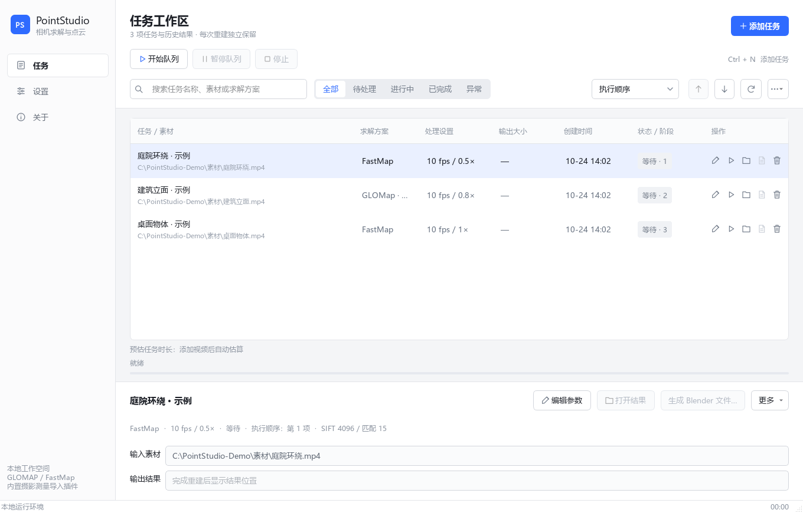

<div align="center">

# PointStudio

**从视频到相机轨迹、彩色点云与 Blender 工程**

Windows 桌面工具 · PySide6 / Qt 6 · **v1.0.1** · 2026-10-24

[下载 v1.0.1](https://github.com/DingBuDoa/PointStudio/releases/tag/v1.0.1) · [使用指南](#开始使用) · [源码开发](docs/DEVELOPMENT.md) · [更新记录](CHANGELOG.md) · [第三方项目](THIRD_PARTY_NOTICES.md)

</div>



## 功能

- **视频处理**：FFmpeg 抽帧，支持原始 / 自定义帧率、分辨率缩放，以及可选 JPG 序列帧导出。
- **两种求解方案**：**FastMap-更高速度 / GLOMap-更高精度**，使用 COLMAP 提取特征与匹配图像。
- **自动任务队列**：独立任务参数、上下箭头调整优先级、暂停后续任务、停止当前任务与失败重试。
- **Blender 导出**：相机关键帧、原生彩色点云与同步视频背景；支持选择 Blender 版本并在后台生成工程。
- **项目与日志**：搜索、筛选、结果目录、诊断日志、历史记录及项目回收目录。
- **GPU 状态提示**：GLOMap 回退 CPU 时提示原因，继续求解与导出。

## 开始使用

普通用户请下载 **v1.0.1 Windows x64 便携发行包**。GitHub 的 **Code → Download ZIP** 是源码，未附带 Python、CUDA 与求解器运行文件。

分卷发行包需要同时下载 `.zip.001`、`.zip.002`、`Merge-PointStudio.ps1` 和 `SHA256SUMS.txt` 到同一个文件夹。在 PowerShell 中运行：

```powershell
powershell -NoProfile -File .\Merge-PointStudio.ps1
```

脚本先检查分卷 SHA-256，再合并为完整 ZIP。解压合并后的 ZIP，将整个目录放到可写位置，双击 **Start.bat**。

1. 添加视频，选择求解方案和处理参数。
2. 按需勾选序列帧与自动生成 Blender 文件。
3. 用上下箭头安排顺序，点击“开始队列”。
4. 完成后打开结果，或选择点云结果生成 Blender 工程。

## 环境要求

| 项目 | 要求 |
| --- | --- |
| 系统 | Windows 10 / 11 x64 |
| 显卡 | 兼容的 NVIDIA GPU 与驱动；当前没有完整的纯 CPU / AMD 重建模式 |
| Blender | 导出工程需要另行安装 Blender 4.0 或更新版本；已实测 4.2 与 5.2 |
| 依赖 | 便携版附带 Python、Qt、PyTorch CUDA、FFmpeg 与求解器，无需另装 CUDA Toolkit |

便携版解压后约 **5.21 GiB**，项目结果还需要额外空间。显存占用随帧数、图像尺寸和场景复杂度变化；FastMap 使用分块策略，仍可能遇到显存不足。

GLOMap 的 CPU 回退只涉及相应求解阶段，特征提取与匹配仍使用 GPU。软件会保留提示与完整日志；真实求解错误仍会报告失败。

## 输出结构

```text
output/
  项目名称/
    point could/           点云与完整 COLMAP 模型
    log/                   当前任务全部日志
    video/                 可选 JPG 序列帧
    项目名称_4.2.blend      文件名包含所选 Blender 版本
    _cache/                数据库、处理帧与必要中间文件
```

相机背景使用 `_cache/images`，请保留缓存。重名项目自动增加序号，已有工程不会覆盖。移入项目回收目录会移动项目及缓存，原视频保留。

## 源码与验证

仓库包含界面、任务调度、导出逻辑、本地适配 FastMap 与摄影测量导入插件源码；运行依赖通过便携发行包提供。[开发说明](docs/DEVELOPMENT.md)介绍目录、环境准备和验证方法。

1.0.1 已通过 **35 项自动回归**、真实短片求解与 Blender 4.2 导出验证。Blender 5.2 的点云与背景另有专项验证；未穷举所有 Blender 版本、显卡和驱动组合。

## 项目来源

| 项目 | 集成版本 | 用途 |
| --- | --- | --- |
| [FastMap](https://github.com/pals-ttic/fastmap) | 0.1，本地适配 | 相机求解与稀疏重建 |
| [GLOMAP](https://github.com/colmap/glomap) | 本地 CUDA / cuDSS 构建 | 全局运动恢复 |
| [COLMAP](https://github.com/colmap/colmap) | 3.12.3 · 74b2be9 | 特征与匹配 |
| [FFmpeg](https://github.com/FFmpeg/FFmpeg) | 7.1.1 | 解码、缩放与抽帧 |
| [Photogrammetry Importer](https://github.com/SBCV/Blender-Addon-Photogrammetry-Importer) | 3.2.1，本地适配 | Blender 摄影测量数据导入 |

各第三方组件遵循其原有许可；版权与许可声明保留在对应源码和运行包中，详情见 [THIRD_PARTY_NOTICES.md](THIRD_PARTY_NOTICES.md)。PointStudio 自有代码的统一许可证尚未指定。
